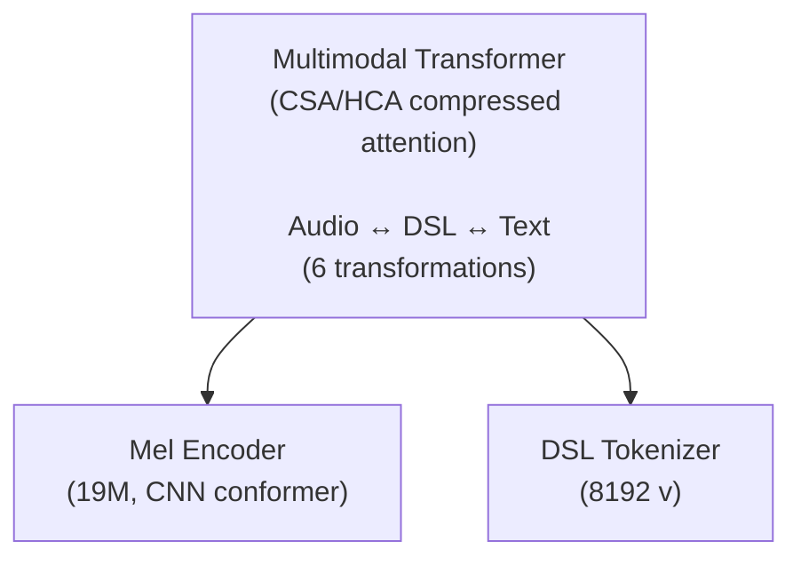

近日，前沿大模型如 Gemini 4，GPT 6 与 Claude 5 系列的多模态能力过于强大，世界知识过于充足，甚至产生了类似于“审美”的东西，以至于可以一次写出像模像样的钢琴曲了。

将乐谱文件（musicxml 或 LilyPond 文件）作为上下文放到 LLM 的输入中，并提出相关要求（扒谱或改编），LLM 就可以通过读取纯文本的方式对乐谱进行方便的书写了，不需要真正使用视觉功能去看预览乐谱或在 MuseScore 上的 GUI 点来点去，也不需要现写 MIDI 的转换脚本；这往往会让 LLM 的注意力分散到文件解析上，所产生的乐谱质量就会有所下降。我们希望 LLM 可以专注于音乐（旋律、和声……）本身，所以最好采用纯文本格式与 LLM 交流。

<!-- more -->

# 程序化写作

一切的基础：[Tone.js](https://tonejs.github.io/)

[Janjs/music-as-code](https://github.com/Janjs/music-as-code)

## Strudel

[Strudel](https://strudel.cc/) is a browser-based live-coding environment for algorithmic music, based on the Tidal Cycles pattern language.

[VibeCodinPie](https://github.com/ShanghaitechGeekPie/VibeCodinPie)：AI 驱动的互动 Live Coding 音乐演出系统

## SuperCollider

[SuperCollider](https://supercollider.github.io/) is a programming language, audio server, and desktop environment for synthesis and algorithmic music.

# 乐谱写作

前沿 LLM 因框架的变化而表现出的编程能力变化并不大，如在 Codex, Claude Code, Pi 等框架下都能够很好的完成编程与通用任务。[HarnessTax](https://arena.ai/blog/coding-agents-harness-tax) 比较了七个模型在 Claude Code, Codex CLI 和 Pi 上的表现，在两个编程评测集上，其得出了框架的选择对模型的成功率影响并不大的结论，但同一模型取得相近成功率的成本最多可相差约五倍。

> 事实上，存在一些公认调教比较差的框架如 Antigravity，但大多数流行的框架都能够让模型很好地完成编程任务。

另一项研究 [Pairing Matters: Performance, Failures, and Efficiency in Lightweight Coding Agents](https://arxiv.org/abs/2610.32131) 则针对轻量模型，观察到了更大的成功率差距。因此可以认为，前沿 LLM 的各项能力能力已经泛化至模型中，与框架是“弱耦合”的。

推论到音乐创作方面，我们或许可以推断：使用不同的“框架”去编辑乐谱，无论是直接编辑 LilyPond 纯文本记谱，抑或是直接修改 musicxml 或 MuseScore mscz 乐谱文件，还是使用 Python 生成这些乐谱，创作出来的乐谱不会因为框架或每次做谱所需要的基础程序写作的复杂性而改变太多。

但这与直觉相反。我们的直觉是，LLM 的注意力可能会因为完成辅助性的工作而减少对音乐本身的关注度；提供的现成工具越少，AI 需做的乐谱本身之外的努力就越多，这从直觉上来看是并不好的。理想状态是，AI 通过编辑纯文本即可完成乐谱的写作，不用额外写作 Python 或辅助处理脚本。

因此，虽然可能影响并不大，但我们也并不希望让 AI 在每次创作音乐时都要从头写一遍 Python 编辑与渲染的脚本。在调研过程中，发现了不少专门为人类可读纯文本而设计的音乐语言。下面列举几个。

## music21

[music21](https://music21.org/) 一个 Python 库，提供了程序化写作乐谱与导入导出的工具。
```bash
pip install music21
```

但我们还是不希望 AI 每次都要写 Python 文件，所以还是往下看吧。

## LilyPond + lytk

[LilyPond](https://lilypond.org/) 是一种可以通过纯文字来写乐谱的语法格式与对应的编译器，天然适合 [LLM](https://baike.baidu.com/item/%E6%BA%9C%E6%BA%9C%E6%A2%85/49910021) 的纯文字输出属性，因此可以使用 LilyPond 让 LLM 写作或改编乐曲。

人类可以通过 [Frescobaldi](https://frescobaldi.org/) 提供的 GUI 界面来对 LilyPond 乐谱进行可视化编辑与导入导出。同时也有 [Hacklily](https://www.hacklily.org/) 网页版在线编辑器。

可以加上 [Janjs/music-as-code](https://github.com/Janjs/music-as-code) 中的 [LilyPond Skill](https://github.com/Janjs/music-as-code#-lilypond) 部分作为 Skill 来优化流程。

LilyPond 虽然本身确实是人类可读的纯文本，但可能并不适合 LLM 对乐谱的创作。实测下来，在不提前说明或没有加入 Skill 的情况下，LLM 依然没有输出纯文本 LilyPond 文件，而是写了带有 `music21` 库的 Python 编辑乐谱的脚本。

## TMDLang

- 语言本体：[aguai/TMDLang](https://github.com/aguai/TMDLang)
- 使用 Swift 的本地工具实现：[TMDLang/TmdSwift](https://github.com/TMDLang/TmdSwift)
- 文档：[TMD](https://tmdlang.github.io/)
- 在线创作平台：[TMD Studio](https://tmdlang.github.io/Tmd-TS/)

它的定位是“用文字记录旋律、创作音乐与 AI 协作的工作流”，摘录一段 [说明文档](https://tmdlang.github.io/#_1) 如下：

> TMD 的特色是使用相对音高、将歌曲段落模块化，并内建简化的转调命令。这能大幅压缩信息量，用简短文字描述歌曲；在 AI 时代，还能节省 token，避免生成错误内容。  
> MusicXML、LilyPond、ABC notation 等纯文本记谱语法已相当成熟，AI 也能产生这些格式；TMD 无法取代它们所擅长的领域。  
> 这些格式诞生时，人机互动的对象往往是打印机：乐曲完成后，印出精确乐谱供乐手阅读与演奏。在 AI 时代，人机互动则变成与 AI 模型互动。MusicXML、LilyPond 与 ABC notation 为乐手服务，TMD 则记录最初的作曲意图，也能透过工具转换成上述格式。  
> MusicXML 与 LilyPond 虽然严谨，也有大量乐谱采用，但语法复杂。创作初期输入心中旋律时负担较大，AI 产生乐谱后，人类也较难修改。  
> ABC notation 虽然语法较简单，但最初是为记录固定音高的单轨旋律、再转成五线谱而设计。遇到多个乐器时，必须分别记录每个乐器的每个小节；若乐器从中途才进入，很容易产生大量休止符。对 AI 而言，这些休止符会造成语法干扰，容易计算错误，使乐器进入时间不正确。  
> 在 TMD 中，乐谱可切成多个段落；某段未使用某种乐器时，可以完全不写，让 AI 专注于需要注意的地方。

### 使用方法

[TMD CLI](https://tmdlang.github.io/cli/) 以 Windows 为例，先使用 Node.js 全局安装 tmdlang：
```bash
npm install -g tmdlang
tmd --help
```

[TMD VS Code 套件](https://tmdlang.github.io/vscode/) 再打开 vscode，插件搜索 TMD Music Language。小众冷门插件，现在算上我只有 6 个安装。安装好后就可以在 vscode 里支持其写作了。

[AI 協同寫歌](https://tmdlang.github.io/ai_agent/) 安装 Skill 与 MCP 到 Codex 中：
```bash
tmd --install-skills
# 目前没有 Codex 支持
# tmd --install-mcp
```

在设置里新建 MCP，配置如下即可。
```json
{
  "mcpServers": {
    "tmd": {
      "command": "tmd",
      "args": [
        "--mcp"
      ]
    }
  }
}
```

更多使用场景如动机扩写、和声配器等参见文档即可。总算可以完全脱离 Python 脚本的写作进行歌曲创作与渲染了。而且提供了超级无敌多的内置导入导出功能。

## MCP Music Studio

[linxule/mcp-music-studio](https://github.com/linxule/mcp-music-studio)

把上面讨论的程序化写作和乐谱写作都包含进去了。乐谱写作通过 ABC 记谱法，可以渲染成五线谱；程序化写作使用 Strudel。

## 讨论

TMDLang 和 LilyPond 格式看起来很好对吧！问题在于，这俩很小众，没多少人用，LLM 现在语料也不足，每次看都得现学一下规则；不像 ABC 记谱法一样已经内置在 AI 的心中了。这个学习成本也有可能会影响一些 AI 对音乐本身的创作。而且 TMDLang 的优势之一，LilyPond 也能用变量拆分乐段、复用动机和移调。

因此，笔者推荐的工作流如下：
- 不硬性规定使用哪种语言进行编写
- 安装 LilyPond + [LilyPond Skill](https://github.com/Janjs/music-as-code#-lilypond) 作为 LilyPond 部分的工作流；
- 安装 TMDLang 的 Skills 和 MCP 作为 TMDLang 部分的工作流；
- 安装 MCP Music Studio 作为实时渲染 MCP 与插件；
- 同时硬性说明不要使用 Python `music21` 创作旋律，而是通过纯文本写作 ABC / LilyPond / TMDLang 进行旋律与和声的创作，专注于音乐本身。

## 其它工作流

### MuseScore MCP

咋这么多？

- [ghchen99/mcp-musescore](https://github.com/ghchen99/mcp-musescore)：实时操作打开的谱。`get_score` 按小节范围和谱表返回紧凑的 LilyPond，也可返回 JSON。文档描述了同谱表多声部的读取。写入通过加音符、休止、和弦音、延音线等动作，可以批量提交。LilyPond 是读取格式，写入侧接收动作序列。另有较完整的反复、段落标注和鼓谱整理工具。
	- Python + QML 插件
- [JordanSucher/musescore-mcp](https://github.com/JordanSucher/musescore-mcp)：实时操作打开的谱。通过游标移动、选区和 `processSequence` 输入音符、休止、连音组等。源码里多项单独的编辑工具被注释掉，主要通过批量动作入口调用。无法处理同一谱表内的多个声部。
	- Python + QML 插件
- [tskovlund/mcp-score](https://github.com/tskovlund/mcp-score)：写 `music21` 脚本生成 MusicXML。在线编辑可加音符、力度和和弦标记等。`render_score` 则通过 MuseScore CLI 从文件导出 PDF、PNG、MIDI、MP3、WAV 或 MusicXML。
	- Python
- [nukeop/musescore-mcp](https://github.com/nukeop/musescore-mcp)：直接读写 `.mscx` 文件。通过 `read_measures` 和 `write_measures` 接收紧凑文本，由 MCP 写入 .mscx，项目定位是主旋律与和弦谱。能一次替换连续多小节，并校验每小节时值。还有新建乐谱、变拍、反复、房子和换页工具。
	- *TypeScript + Bun*
	- 紧凑文本的想法很好，但是我们刚刚已经在 ABC 记谱法和 TMDLang 中讨论过很多了。所以拜拜啦。

### acorde

[kent-tokyo/acorde](https://github.com/kent-tokyo/acorde) 基于 Rust CLI 和本地 MCP 的读写结构化乐谱后端。虽然无需 Python 但是需要 Rust，拜拜了。

# MStruct

休息一下，看点不是乐谱写作的。

[MStruct简介](https://cn.mstruct-archive.com/docs) 这是一个基于 [Notations of simai](https://w.atwiki.jp/simai/pages/1003.html)（舞萌铺面语法）启发的基于文本的音乐结构描述与呈现系统。注意这不是乐曲写作，而是音乐上的和声分析语言。

# DAW

## AI 原生 DAW

一个尝试：[CompilationFail/open_compose: Music Composing Assistant, in progress.](https://github.com/CompilationFail/open_compose)。

引用一段 README 如下。

> A universal music description language that bridges AI generation, human editing, and audio engines — enabling a multimodal model to generate structured, editable music projects instead of opaque audio.

1. **A DSL** (`.ocp` files) — a human-readable, engine-agnostic music notation format covering notes, instruments, arrangement, mixing, and effects
2. **A multimodal AI model** — a transformer that understands and generates across audio, DSL, and natural language
3. **A rendering pipeline** — pluggable audio engines (FluidSynth, TiMidity++, Surge XT) that turn DSL into sound



The model learns bidirectional mappings between all three modalities:

| # | Direction | What it enables |
|---|-----------|----------------|
| 1 | Audio → DSL | Transcribe music from audio to editable notation |
| 2 | DSL → Audio | Render/preview a composition (with engine selection) |
| 3 | Audio → Text | Describe what music sounds like |
| 4 | Text → Audio | Generate audio from description |
| 5 | DSL → Text | Explain an arrangement, critique a mix |
| 6 | Text → DSL | "Write a jazz piano ballad in Bb major" → full project |

Plus specialized tasks:
- **Mixing knowledge**: audio + stripped DSL → full DSL with production decisions
- **Arrangement**: progressive instrument builds with explanations

对钢琴，有
- **Pattern/Clip model**: Patterns own instrument + notes + hits. Tracks layer clips at timeline positions. Same pattern can appear on multiple tracks at different times.
- **Notes**: Scientific pitch (C4, F#5, Bb3), all durations (w, h, q, 8th, 16th, 32nd, 64th), dynamics (ppp→fff), chords via `@beat` notation
- **Tuplets**: Classic triplet `qt`, arbitrary `q5:4` (5:4), `q7:8` (7:8)
- **Multi-note ties**: `C4 q~h~q` chains across multiple durations
- **Velocity**: Numeric `v=95` overrides dynamics for precise velocity control
- **Grace notes**: `@grace` prefix for ornamental notes
- **Lyrics/text**: `text="La la la"` per-note annotations
- **Articulations**: 31 types — legato, staccato, pizzicato, tremolo, palm mute, ghost note, sforzando, etc.
- **Expression**: dynamic curves, vibrato, pitch bend, brightness, pressure (MPE)

## FL Studio / REAPER MCP

未知领域……
